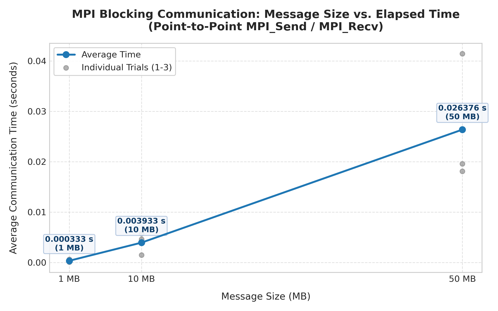

# HPC Tutorial 5: MPI Programming Lab Report

Name: Student  
Course: High Performance Computing (HPC-2026)  

---

## 1. Overview
In this lab, I worked on MPI (Message Passing Interface) programming using C. I implemented 5 problems:
1. Basic Hello World with MPI
2. Blocking Point-to-Point communication and time measurement
3. Non-blocking communication and overlapping computation
4. Ring communication topology
5. 2D grid topology (and Cartesian communicator extension)

---

## 2. How to Compile and Run

```bash
# Compile all programs
make

# Run Problem 1
mpirun -np 2 ./bin/problem1_hello
mpirun -np 4 ./bin/problem1_hello

# Run Problem 2
mpirun -np 2 ./bin/problem2_blocking

# Run Problem 3
mpirun -np 2 ./bin/problem3_nonblocking

# Run Problem 4
mpirun -np 4 ./bin/problem4_ring

# Run Problem 5
mpirun -np 4 ./bin/problem5_grid
mpirun -np 4 ./bin/problem5_cartesian
```

---

## 3. Problem 1: Hello World with MPI

I wrote a simple program using `MPI_Init`, `MPI_Comm_rank`, `MPI_Comm_size`, and `MPI_Finalize`.

### Output with 2 processes:
```text
Hello World from process 0 of 2
Hello World from process 1 of 2
```

### Output with 4 processes:
```text
Hello World from process 0 of 4
Hello World from process 1 of 4
Hello World from process 2 of 4
Hello World from process 3 of 4
```

### Why different ranks are printed:
`mpirun` launches multiple separate instances of the program. The MPI runtime assigns each instance a unique rank from 0 to `size - 1`. When each process calls `MPI_Comm_rank` and prints it, it displays its own rank number.

---

## 4. Problem 2: Blocking Communication

I sent integer arrays from Process 0 to Process 1 using `MPI_Send` and received them with `MPI_Recv`. I tested 1 MB (250,000 ints), 10 MB (2,500,000 ints), and 50 MB (12,500,000 ints) for 3 trials each, measuring time with `MPI_Wtime()`.

### Timing Results:

| Message Size | Trial 1 (s) | Trial 2 (s) | Trial 3 (s) | Average Time (s) |
| :--- | :--- | :--- | :--- | :--- |
| **1 MB** | 0.000593 | 0.000312 | 0.000094 | **0.000333** |
| **10 MB** | 0.005732 | 0.004594 | 0.001475 | **0.003933** |
| **50 MB** | 0.041450 | 0.019576 | 0.018103 | **0.026376** |

### Graph:


### Answers to Questions:
1. **Why does transfer time increase as message size grows?**  
   Bigger messages have more data that needs to be copied into buffers and sent across the network/memory.
2. **Does doubling the message size always double the time?**  
   No. For small messages, initial startup latency is the main factor. For large messages, bandwidth and memory copying dominate.
3. **What influence do latency, bandwidth, and system load have?**  
   Latency sets the minimum time to start a message. Bandwidth determines how fast data flows. System load causes small timing variations between runs.
4. **What does blocking mean? Does MPI_Send returning mean receiver got the data?**  
   Blocking means the function waits until its buffer can be reused. `MPI_Send` returning only means the data has left the sender buffer, not that the receiver has finished processing it.

---

## 5. Problem 3: Non-Blocking Communication and Overlap

I used `MPI_Isend` and `MPI_Irecv` to send/receive in the background while both processes ran a dummy calculation loop. Then I used `MPI_Wait` before accessing the data.

### Comparison Table:

| Message Size | Blocking Time (s) | Non-Blocking Time (s) | Observation |
| :--- | :--- | :--- | :--- |
| **1 MB** | 0.119610 | 0.119207 | Almost same (computation took most time) |
| **10 MB** | 0.109266 | 0.111917 | Similar time due to OS scheduling noise |
| **50 MB** | 0.135769 | 0.113964 | **Saved ~0.022 seconds** due to overlap |

### Observation:
At 50 MB, non-blocking saved time because communication and computation were running simultaneously instead of one after the other.

---

## 6. Problem 4: Ring Topology

I arranged 4 processes in a ring where:
- `next = (rank + 1) % size`
- `prev = (rank - 1 + size) % size`

### Deadlock and Solution:
If all processes call `MPI_Send` first, they all block waiting for a receiver, causing a deadlock. I solved this using `MPI_Sendrecv`, which sends and receives simultaneously without blocking.

### Output:
```text
Process 0: previous = 3, next = 1
Process 1: previous = 0, next = 2
Process 2: previous = 1, next = 3
Process 3: previous = 2, next = 0

Process 0 sent 0 to 1 and received 30 from 3
Process 1 sent 10 to 2 and received 0 from 0
Process 2 sent 20 to 3 and received 10 from 1
Process 3 sent 30 to 0 and received 20 from 2
```

---

## 7. Problem 5: 2D Grid Topology

I mapped 4 processes to a 2x2 grid using:
- `row = rank / 2`
- `col = rank % 2`

Each process identified its Up, Down, Left, and Right neighbors, setting boundary edges to `MPI_PROC_NULL`.

### Output:
```text
Process 0 at (0, 0) -> Up: -2, Down: 2, Left: -2, Right: 1
Process 1 at (0, 1) -> Up: -2, Down: 3, Left: 0, Right: -2
Process 2 at (1, 0) -> Up: 0, Down: -2, Left: -2, Right: 3
Process 3 at (1, 1) -> Up: 1, Down: -2, Left: 2, Right: -2

Process 0 received -> Up: -1, Down: 200, Left: -1, Right: 100
Process 1 received -> Up: -1, Down: 300, Left: 0, Right: -1
Process 2 received -> Up: 0, Down: -1, Left: -1, Right: 300
Process 3 received -> Up: 100, Down: -1, Left: 200, Right: -1
```
*(Note: -2 is `MPI_PROC_NULL`, which means boundary/no neighbor).*

I also implemented `problem5_cartesian.c` using `MPI_Cart_create` and `MPI_Cart_shift`, which handles grid topology coordinates and shifts automatically.

---

## 8. Conclusion
In this lab, I learned the basics of MPI, measured blocking communication times for different array sizes, overlapped communication with calculation using non-blocking functions, and avoided deadlocks in ring and grid topologies.
